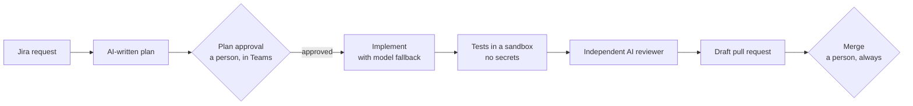

# An AI agent team with human approval

**Status:** in development · **Role:** designing and building · **Setting:** internal platform at a clinical-trial technology company

## Context

AI can draft small, well-described code changes. Letting an agent merge its own code is not acceptable, so a person approves every plan and every merge.

## Approach

A Jira request becomes an AI-written plan that a person approves in Microsoft Teams. Only the approved plan is built.

## Key decisions

**People decide at both ends.** A person approves the plan before any code is written and merges the pull request at the end. The AI can never approve or merge its own work.

**Do not depend on one model.** The implementer uses Claude Code, Codex and AWS Bedrock with automatic fallback between them.

**Check the work independently.** Tests run in a sandbox with no secrets, and a separate AI reviewer checks the change before the draft pull request is opened. Handoffs between stages are HMAC-signed.

## Status

In development, and being moved into an app on the reusable app template.
