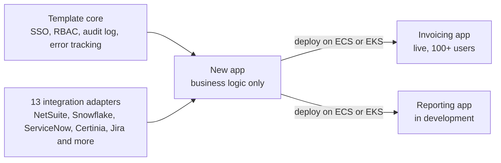

# A reusable app template with 13 integration adapters

**Status:** in use · **Role:** designed and built · **Setting:** internal platform at a clinical-trial technology company, 200+ users

**Interactive diagram:** [open it on the portfolio site](https://shareefsyeds.github.io/diagrams/template.html). You can click each part, zoom and switch between light and dark.

## Context

Every new internal app needed the same things: Entra ID sign-in, roles, an audit log, integrations with business systems and a deployment. Rebuilding them for each app would repeat the same work and leave each app with its own version of the basics.

## Approach

I extracted the platform's core into a project template built with the Copier project generator. A new app starts with the basics in place, so the work goes into its business logic.

**What every new app starts with:**

- Entra ID sign-in and role-based access control
- An audit log and error tracking
- 13 integration adapters, including NetSuite, Snowflake, ServiceNow, Certinia and Jira
- Deployment to ECS or EKS

## Key decision

**Configure in the database, not in code.** Integration settings, AWS account connections, email and file templates and runtime configuration all live in the database. They change from an admin screen, with no code change or redeploy.

## Outcome

- A consultant invoicing app built on the template is live for 100+ users. It handles NetSuite payment status, multi-step approvals and GL coding, and replaced a Microsoft Power Apps app.
- A centralized reporting app that replaces a UiPath bot is in development on the same template.
- An AI agent team is being moved into an app on the template as well.
