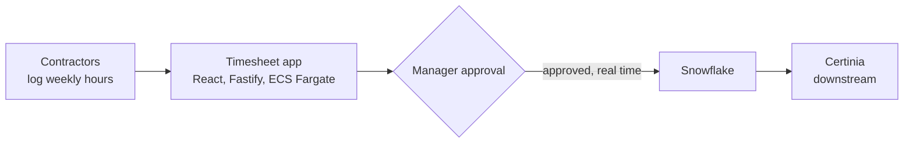

# Contractor timesheets with real-time Snowflake sync

**Status:** live · **Role:** built with two colleagues · **Setting:** warehouse contractors in the UK and Austria, about 30 users

**Interactive diagram:** [open it on the portfolio site](https://shareefsyeds.github.io/diagrams/timesheets.html). You can click each part, zoom and switch between light and dark.

## Context

Warehouse contractor hours reached finance through a weekly batch job, so the data was up to a week old, and the batch had stopped running.

## Approach

A timesheet app where contractors log hours and managers approve them. Approved hours sync from the database to Snowflake in real time and flow on to Certinia.

**Stack:** React, Fastify, Amazon RDS and ECS Fargate, all managed in Terraform.

## Outcome

- Live for about 30 contractors and managers in the UK and Austria
- The weekly batch is gone, and finance sees hours as soon as they are approved
