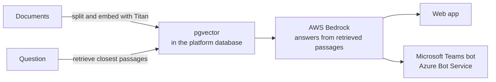

# A document assistant on Bedrock

**Status:** pilot · **Role:** designed and built · **Setting:** internal platform at a clinical-trial technology company, pilot with selected users

## Context

The goal was to make internal documents answerable in plain language, inside the tools people already use.

## Approach

Retrieval-augmented generation (RAG). Documents are split, embedded with Amazon Titan and stored in pgvector inside the platform database. A question retrieves the closest passages, and a model on AWS Bedrock answers from them.

## Key decisions

**Keep vectors in the existing database.** Embeddings live in pgvector on the platform's Aurora PostgreSQL database, next to the rest of the platform data, rather than in a separate vector store.

**Meet people where they work.** The same assistant answers in the web app and in Microsoft Teams, through a bot on Azure Bot Service.

## Outcome

- Running as a pilot with a small group of selected users while answer quality is checked
- Available in the web app and in Microsoft Teams
