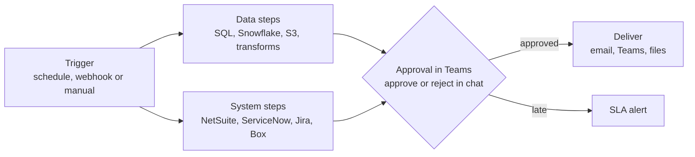

# From custom code to low-code workflows

**Status:** live · **Role:** designed and built · **Setting:** internal platform at a clinical-trial technology company, 200+ users

**Interactive diagram:** [open it on the portfolio site](https://shareefsyeds.github.io/diagrams/workflow.html). You can click each part, zoom and switch between light and dark.

## Context

Finance, supply chain, clinical-operations and IT teams kept asking for the same kind of job: pull data from one system, check it, get someone to approve it, and send the result somewhere else. Each one used to be a script.

Every script was a small software project. Someone wrote the logic and the plumbing (drivers, retries, logging, alerts), hosted it on a server or a stack, and then looked after it for years. AI coding assistants make scripts faster to write, not cheaper to own, and a job living on one server can vanish silently when that server is rebuilt.

## Approach

A visual workflow engine where jobs are composed from 50 ready step types, with a Python step for anything not covered yet. Scheduling, credentials, approvals in Microsoft Teams, audit and monitoring come with the platform instead of being rebuilt per job.

**Step types include:** SQL and PL/SQL, Snowflake, NetSuite, Certinia, ServiceNow, Jira, Box, S3, SSH, SFTP, SMB, WinRM, email, branches, loops, waits, sub-flows, schedules and data transforms.

## One place from draft to retirement

| Stage | What the platform provides |
|---|---|
| Build | Visual designer, with every save validated and versioned |
| Run and fix | Live status for each step, retry with the same inputs, no server logins |
| Govern | Azure AD sign-in, roles per team and flow, an audit log of every change and run |
| Support | Dashboard, SLA and error alerts, catch-up after outages, one-click rollback |

## What moves, and what stays as code

- **Moves to the engine:** scheduled reports and extracts, integrations between internal systems, runbooks with approvals, housekeeping tasks.
- **Stays as code:** product features, heavy compute and large data pipelines, jobs that must run on the data server.

The idea is to pay for the plumbing once, not for every job.

## What one automation costs over its life

These are planning estimates for AI-assisted code plus hosting, not measurements. The 15-minute build is measured on one real flow.

| | Script with AI help | Workflow engine |
|---|---|---|
| Simple job, build | 3 to 7 hours including hosting | 15 to 30 minutes |
| Complex job, build | 20 to 36 hours | 2 to 4 hours |
| Simple job, upkeep per year | 6 to 8 hours | about 1 hour |
| Complex job, upkeep per year | 12 to 16 hours | 2 to 4 hours |
| Twenty simple jobs | about 100 hours to build, then about 140 hours a year | under 10 hours to build, then about 20 hours a year |

## Outcome

- A real flow (Jira to CSV, a Teams approval, then email) was built in 15 minutes with no code
- 50 step types cover the systems the business teams use every day
- Approvals happen in Teams, where people already work, and every run is audited
